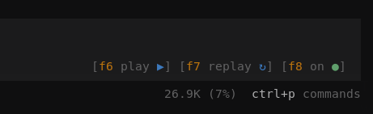

# @semirhuduti/opencode-tts-voice

Thank you to the original author for this useful tool. I forked this to add some features for my own workflow.

For a quick start guide see [QUICKSTART.md](QUICKSTART.md).

Below this line, the original README is left as is.

---

Voice output plugin for OpenCode powered by Kokoro, with TUI shortcut support for controlling playback.



<a href="https://www.buymeacoffee.com/semirhuduti" target="_blank"></a>


## ALPHA

Still wip, make sure to install sharp versions if you want a bit more reliability.

## Features

- reads assistant responses aloud while they stream in the TUI
- speaks question tool prompts from the active visible session
- adds TUI shortcuts for pause, history replay, replay latest response, and toggle on or off
- supports configurable voice, speed, model, precision, and playback settings
- uses local playback via `mpv`, `ffplay`, `paplay`, or `aplay`
- prefers GPU-capable execution when available and falls back to CPU automatically

## Requirements

- Linux, macOS, or Windows
- OpenCode V2 (targeted against the 2.3.2 plugin API)
- Node.js 20.9 or newer, npm, and Bun for building and testing from source
- A build destination: the build writes to `dist/`
- one of `mpv`, `ffplay`, `paplay`, or `aplay` available on the system. `mpv` is recommended.

Optional:

- CUDA and cuDNN runtime libraries for GPU execution

## Install

This fork is being migrated to OpenCode V2 and has not yet been validated. Do not
install the original npm package if you intend to run this fork.
After changing dependencies or overrides, regenerate the lockfile before testing.

The V2 port uses plugin-scoped storage; it does not import the old V1 speech
toggle, so speech is enabled by default on first use.

After installing the fork's dependencies and building it, point a test project's
`opencode.jsonc` at the absolute path of this checkout:

```jsonc
{
  "$schema": "https://opencode.ai/config.json",
  "plugins": [
    { "package": "/absolute/path/to/opencode-tts-voice", "options": {} }
  ]
}
```

OpenCode loads the server and TUI parts together. Test in an isolated environment
before enabling the plugin globally. The V2 port's history picker, streaming,
question forms, shortcuts, and shared toggle still need runtime verification.

### Build and test

Run these commands from the root of this checkout. Install dependencies first
(this updates the lockfile if needed):

```sh
npm install --ignore-scripts
```

This skips dependency lifecycle scripts rather than running them automatically.
Some native dependencies may require those scripts on your platform; investigate
the error and the relevant scripts before choosing to run them.

Check the resolved dependencies for known npm advisories, build the TypeScript
and TUI bundle, and run the automated tests:

```sh
npm audit
npm run build
npm test
```

Run `npm run build` again after changing source files: the audio test launches
the built helper from `dist/`.

The root `package.json` overrides `sharp`, `glob`, and `minimatch` to address
known advisories. These versions fall outside some upstream dependency ranges,
so compatibility must be tested. npm and Bun apply overrides from the root
project only; another project installing this package as a dependency may ignore
these overrides and resolve a different dependency tree. This is not a security
guarantee for a published package.

To generate a short clip on CPU and validate its WAV data without playing it:

```sh
npm run test:audio
```

The audio test starts the built helper in a Node child process. It downloads the
default Kokoro model from Hugging Face if it is not already cached; the download
may take time and consume disk space. The test does not exercise OpenCode itself.
To also listen to the generated clip through a supported installed player:

```sh
OPENCODE_TTS_TEST_PLAY=1 npm run test:audio
```

For example, on macOS with Homebrew, install the recommended player if needed:

```sh
brew install mpv
```

Automatic player selection does not currently include macOS's built-in `afplay`.
If playback is silent, check the system's sound output and volume.

Finally, test the built fork in a disposable OpenCode project before enabling it
globally: check live speech, pause, replay, the history picker, question prompts,
the toggle, reload, and helper cleanup. An OpenCode TUI may select a different
helper runtime from the Node process used by the audio test, so validate the
actual runtime too. A passing audit and tests reduce uncertainty but cannot
guarantee security or compatibility.

Speech generation runs in a persistent helper service process so Kokoro/ONNX work and WAV encoding do not block the TUI event loop. Because it is a separate operating-system process, you can lower or cap only speech generation without limiting OpenCode itself.

## Spoken-Friendly System Prompt

This package includes built-in system prompt guidance that helps agents write responses that are easier to understand through speech playback. The runtime sanitizer still cleans up streamed text before playback, but the system prompt improves the source response by encouraging spoken-friendly prose instead of visually dense formatting.

There is no separate skill to install. The server plugin adds the guidance
directly to the session's system prompt when speech is enabled.

The injected system prompt also asks agents to use OpenCode's question tool,
one question per call, so question prompts can be spoken reliably.

## Config

Example project `opencode.jsonc`:

```jsonc
{
  "$schema": "https://opencode.ai/config.json",
  "plugins": [
    {
      "package": "/absolute/path/to/opencode-tts-voice",
      "options": {
        "voice": "am_adam",
        "speed": 1.1,
        "dtype": "q4",
        "speechBlocks": ["message", "idle"],
        "shortcuts": {
          "history": "f5",
          "pause": "f6",
          "skipLatest": "f7",
          "toggle": "f8"
        }
      }
    }
  ]
}
```

The plugin works with defaults, so the `shortcuts` block is optional unless you want custom keybinds.

Use a test project while validating the migration.

## Options

| Option | Type | Default | Description |
| --- | --- | --- | --- |
| `voice` | string | `af_heart` | Voice ID used for speech generation. |
| `speed` | number | `1` | Speech speed. Higher values are faster. |
| `device` | string | `auto` | Preferred execution device. Accepted values: `auto`, `cpu`, `cuda`, `dml`, `gpu`, `wasm`, `webgpu`. The plugin falls back to CPU automatically if the preferred backend cannot initialize. |
| `dtype` | string | `q8` | Model precision. Accepted values: `fp32`, `fp16`, `q4`, `q4f16`, `q8`. |
| `model` | string | `onnx-community/Kokoro-82M-v1.0-ONNX` | Model ID or compatible local model path. |
| `cacheDir` | string | Transformers.js default cache | Directory used for model downloads and cache data. |
| `audioPlayer` | string | `auto` | Playback backend command. `auto` picks the first installed backend from `ffplay`, `mpv`, `paplay`, or `aplay`. `mpv` is recommended. |
| `audioPlayerArgs` | string or string[] | `[]` | Additional arguments passed to the playback backend helper. |
| `speakResponses` | boolean | `true` | Speak streamed assistant responses. |
| `speakSubagentResponses` | boolean | `false` | Speak responses from direct subagent child sessions of the visible session. |
| `speakOnIdle` | boolean | `false` | Speak a message when the session becomes idle. |
| `speakQuestions` | boolean | `true` | Speak question tool prompts when they are asked in the active session. |
| `idleAnnouncement` | string | `Task completed.` | Idle announcement text. |
| `speechBlocks` | string[] | `["message", "idle"]` | Fine-grained speech source filter. Accepted values: `reason`, `message`, `idle`. Reasoning is opt-in. |
| `maxSpeechChunkChars` | number | `1000` | Maximum chunk size sent to the TTS generator. |
| `streamFlushChars` | number | `180` | Target flush size for streamed assistant text. |
| `maxSpeechChars` | number | `2000` | Maximum text length accepted for a single spoken chunk. |
| `fileExtensions` | string or string[] | `[]` | Additional alphanumeric file extensions recognized by speech sanitization. Extends the built-in list. |
| `trimSilenceThreshold` | number | `0.001` | Silence threshold used when trimming generated chunks. |
| `leadingAudioPadMs` | number | `12` | Leading padding preserved before detected speech. |
| `normalPauseMs` | number | `240` | Pause added after normal chunks. |
| `sentencePauseMs` | number | `420` | Pause added after sentence, clause, or newline-ending chunks. |
| `ttsServiceCommand` | string | Resolved Node or Bun runtime | Optional command used to start the TTS helper service. Use this only when wrapping the helper with OS resource controls. |
| `ttsServiceArgs` | string or string[] | `['{helper}']` | Optional helper service arguments. `{helper}` expands to the bundled helper script, and `{runtime}` expands to the Node or Bun executable used for the helper. |
| `shortcuts.history` | string | `f5` | TUI shortcut for opening the previous assistant message picker. Enter plays the selected message, and shift return plays from the selected message forward. |
| `shortcuts.pause` | string | `f6` | TUI shortcut for play or pause. If audio is already playing, it pauses. If playback is idle, it replays the latest assistant response. |
| `shortcuts.skipLatest` | string | `f7` | TUI shortcut for replaying the latest assistant message in the active session. |
| `shortcuts.toggle` | string | `f8` | TUI shortcut for enabling or disabling automatic speech. |

## Limiting TTS CPU Usage

The plugin starts Kokoro generation in a child service process. By default it launches the bundled helper directly. To apply operating-system limits to only speech generation, set `ttsServiceCommand` and `ttsServiceArgs` to wrap that helper process.

The `{helper}` placeholder means the bundled helper script. The `{runtime}` placeholder means the Node or Bun executable used to run that helper. The older `{node}` placeholder is still accepted as an alias for `{runtime}`.

For example, to give speech generation a lower priority, add these values to
the plugin's `options` object:

```json
{
  "ttsServiceCommand": "nice",
  "ttsServiceArgs": ["-n", "10", "{runtime}", "{helper}"]
}
```

This lowers priority rather than imposing a hard CPU cap.

## Logging

Runtime logging defaults to warnings and errors only to avoid terminal redraw pressure in the TUI. Enabled logs are also written beside OpenCode's own logs at `${XDG_DATA_HOME:-~/.local/share}/opencode/log/opencode-tts-voice-<timestamp>.log`. Logs can include previews of spoken text, including at the default warning level. Set `OPENCODE_TTS_VOICE_LOG_LEVEL=silent` to disable plugin logging, or use `debug` or `info` when diagnosing plugin behavior. Helper process logs are silent by default because stdout is used for the helper protocol; set `OPENCODE_TTS_VOICE_HELPER_LOG_LEVEL=warn` or `error` only when debugging helper startup failures.

## Shortcuts

Default TUI shortcuts:

- `f5`: open previous assistant message picker
- `f6`: play or pause speech
- `f7`: replay the latest assistant message
- `f8`: enable or disable speech

The TUI footer displays whether voice is on, off, or in an error state.

The history picker lists up to 50 recent playable assistant messages from the active session's synchronized history. Press `Enter` to play only the selected message, `shift+return` to play the selected message and later playable assistant messages, or `Escape` to close the picker.

`speechBlocks` works as a source filter on top of the speech toggles:

- `speakResponses` enables or disables streamed response playback
- `speakSubagentResponses` enables or disables speech from subagent child sessions
- `speakOnIdle` enables or disables idle announcements
- `speakQuestions` enables or disables question tool prompt playback for the active session only
- `speechBlocks` decides which of `reason`, `message`, and `idle` are allowed to be spoken when those features are active

Form prompt speech reads the first non-hidden, unconditional field title, not answer options or descriptions. Prompts are governed by the voice toggle and pause state, never spoken for subagent sessions, and queued behind current playback.

Removed alpha option names are not accepted as aliases. Replace `playerBin` with `audioPlayer`, `playerArgs` with `audioPlayerArgs`, `readResponses` with `speakResponses`, `readSubagentResponses` with `speakSubagentResponses`, `announceOnIdle` with `speakOnIdle`, `idleMessage` with `idleAnnouncement`, `voiceBlocks` with `speechBlocks`, `speechChunkLength` with `maxSpeechChunkChars`, `streamSoftLimit` with `streamFlushChars`, `maxTextLength` with `maxSpeechChars`, `defaultChunkPauseMs` with `normalPauseMs`, and `clauseChunkPauseMs` with `sentencePauseMs`.

## Publish Notes

Published package entrypoints:

- `./server`: server plugin entrypoint for prompt guidance
- `./tui`: TUI plugin entrypoint for voice playback

This package is intended to be published as a public scoped npm package.

## Playback Backends

Supported backends:

- `auto` (default)
- `mpv`
- `ffplay`
- `paplay`
- `aplay`

To override the backend, set `audioPlayer` and `audioPlayerArgs` in the
plugin's `options` object shown above.

## Voices

The plugin accepts Kokoro voice IDs. Common English voices include:

- `af_heart`
- `af_alloy`
- `af_aoede`
- `af_bella`
- `af_jessica`
- `af_kore`
- `af_nicole`
- `af_nova`
- `af_river`
- `af_sarah`
- `af_sky`
- `am_adam`
- `am_echo`
- `am_eric`
- `am_fenrir`
- `am_liam`
- `am_michael`
- `am_onyx`
- `am_puck`
- `am_santa`
- `bf_alice`
- `bf_emma`
- `bf_isabella`
- `bf_lily`
- `bm_daniel`
- `bm_fable`
- `bm_george`
- `bm_lewis`

`kokoro-js` ships additional voices beyond this list. If upstream adds new voices, you can usually use them directly through the `voice` option.
